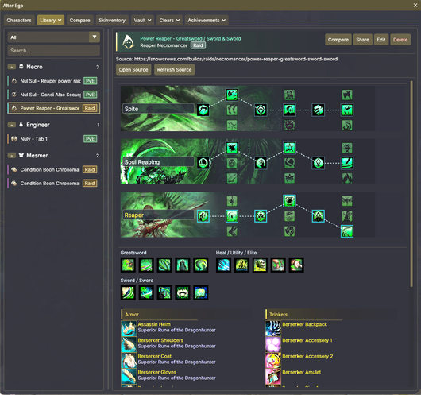
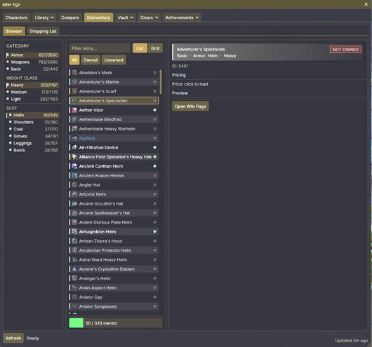
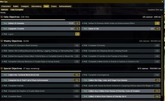
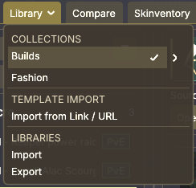

# Alter Ego

> [!IMPORTANT]
> **Unofficial Alter Ego feature fork — not an upstream release.** This repository is forked from [PieOrCake/alter_ego](https://github.com/PieOrCake/alter_ego). Credit for the original addon and its existing features belongs to the upstream project.
>
> **Enhanced version:** this fork's **`main`** branch contains the changes described below. This is a personal feature fork, separate from the original upstream release; these changes have not been submitted upstream.
>
> **Status:** actively used and tested in Guild Wars 2, but still undergoing further in-game evaluation. Development has been AI-assisted.

A Guild Wars 2 addon for [Raidcore Nexus](https://raidcore.gg/Nexus) that lets you view and manage all your characters, equipment, builds, and saved build templates — all without logging in to each character.

## Experimental Composable Loadouts v3 (this branch only)

This **`experiment/composable-loadouts`** branch is a separate, ongoing experiment. It has not been merged into `main` or tested end-to-end in the game. The features below are specific to this branch, and screenshots elsewhere in this README may show the current `main` UI.

- **Independent saved components:** Every Loadout can reference a Base Build, Skills, Weapons, Armor, Trinkets, Runes, Sigils, Infusions, and Relic, plus an optional Fashion appearance. The Loadout viewer still shows individual physical equipment slots, exact item IDs, stats, upgrades, and infusions.
- **Native visual editors:** Components use the shared GW2 specialization/trait artwork, skill-palette rules and icons, stat selectors, and curated rune/sigil/relic catalogs. Numeric IDs remain accessible through advanced controls. Unknown data is preserved; missing optional fields are not created just because the editor was opened.
- **Shared editing or private copy:** **Edit Shared** affects every referencing Loadout. **Copy & Edit** creates a separate component first. Components can be attached to compatible Loadouts, detached for a single Loadout, renamed, duplicated, searched, sorted by usage, and filtered to unused entries.
- **Save Active:** Choose **Complete Loadout**, **New component**, or **Update existing component**. Updating an existing component explicitly warns when other Loadouts share it and requires confirmation. Cross-profession Build/Skills replacement is blocked.
- **Compare:** Grouped, expandable results for all nine component kinds. Runes and infusions compare as aggregate requirements; sigils are aggregated within each weapon set. Utility ordering does not change functional equivalence. Missing information is unverified, never a presumed match.
- **Clipboard interchange:** Copy and paste a single component via Components, or **Copy Portable Loadout** from a saved Loadout and **Paste Portable Loadout** in the Library. Portable Loadouts include their component payloads and optional Fashion reference; imports create new independent component IDs rather than linking to or overwriting existing components.
- **Persistence/migration:** The v3 canonical data is stored separately from the upstream-compatible `build_library.json` mirror. Migration checks exact round-trip reconstruction and preserves a pre-migration backup. Full ZIP Library backups include the v3 component graph; standalone legacy Build JSON is still supported.

**Status:** CI exercises the portable data model, migration, backups, import conflicts, functional comparisons, and Windows x64 UCRT compilation. In-game interaction testing is still pending. Do not remove pre-migration backups or use this experimental branch as the only copy of your saved library.

## What's different in this fork?

The following are **additions or changes relative to the original [PieOrCake Alter Ego](https://github.com/PieOrCake/alter_ego)**, not a list of features inherited unchanged from upstream.

| Area | Changes in this fork |
| --- | --- |
| **Library / Fashion** | Library is a top-level dropdown with **Builds**, **Fashion**, **Import from Link / URL**, and backup **Import / Export**. Hover shows a transient menu; the chevron pins it until a selection or outside click. Build groups and Fashion entries have matching context menus, searchable/filterable sidebars, and shared themed actions. **Save Active Fashion** in the Characters header uses the *active* equipment appearance (not the equipment tab being viewed); wardrobe-link import preserves dyes, skins, outfit data, and supported visibility flags. |
| **Saved builds and Compare** | Save character builds **with equipment**, compare against retrieved build/gear by trait, skill, upgrade, stat, relic, infusion, and utilities, optionally compare exact item IDs, and distinguish differences from missing/unverified data. Agony Resistance and infusion-stat totals are shown across live, saved, edit, and compare views; the recommended AR comparison threshold is capped at 150. |
| **Character-first comparison** | Compare follows the logged-in character by default, auto-selects an appropriate saved build, keeps the **Character / Build Tab / Equipment Tab** selectors together, and shares the Characters tab's per-character refresh timestamp. Manual selection remains available. |
| **Character refresh and live signals** | Refresh the selected character or several characters; optional automatic API refresh on login or elite-specialization change, respecting Nexus's plugin-level automatic-refresh switch; cached-vs-live specialization warnings; and locally tracked **Last Login** sorting. |
| **Vault and Clears** | Revised compact displays, clearer refresh feedback, better completion styling, daily fractal tier/scale information on hover, clearer weekly raid/strike layouts, and more consistent section headers and status presentation. |
| **Weekly Strikes** | Three-column responsive layout; encounters ordered like the in-game raid picker; shortened labels and full-name/expansion tooltips; `? Nexus` shown as **unknown**, not falsely completed or included in the existing 14-objective count. |
| **Weekly Raids** | Single-row **W1–W8** encounter grids at normal widths, with compact labels, per-wing completion totals, expansion/name tooltips, and Emboldened / Call of the Mists indicators. Often-skipped or secondary encounters are visually quieter. |
| **Shared completion styling** | Stronger distinction between available, secondary, and completed entries across Clears, Vault, and Achievements, without dimming entire groups more than necessary. |
| **Snow Crows / MetaBattle import** | Import build pages by URL, including traits, skills, gear, runes, sigils, relics, stat prefixes, and reported infusions where available. Preserve the source URL for **Open Source** / **Refresh Source**. MetaBattle parsing uses primary equipment loadouts and reports supported partial imports rather than inventing missing items. |
| **Multi-account cache reliability** | Account-separated Vault, Clears, Skinventory ownership, and achievement progress; startup restoration, atomic cache saves, legacy single-account migration, stale-response guards, and recovery from truncated skin ownership requests. |
| **Offline UI assets** | Frequently used profession/specialization, crafting, UI, and other fixed icons, plus the bundled Inter font, are embedded in the DLL for offline-first rendering. Unused raid/strike banner payloads and their loader were removed. |
| **Unified UI and editing** | Fixed bottom refresh/status bars on the major tabs, right-aligned **Updated** timestamps, standardized actions/dialogs, improved clipping/padding and button sizing, responsive build/raid layouts, and native right-click **Cut / Copy / Paste / Select All** menus in text inputs. |

**What hasn't changed:** This is still Alter Ego, using [Raidcore Nexus](https://raidcore.gg/Nexus) and [Hoard & Seek](https://github.com/PieOrCake/hoard_and_seek). The fork does not introduce a separate GW2 API credential store or live memory-based gear reads. It keeps the original build-library data and upstream attribution.

**Fashion capture limitation:** The GW2 character-equipment API exposes equipped skin/dye data but not all saved in-game Fashion Template slots or outfit/visibility states. Equipment-derived captures are flagged partial. Import a complete in-game Wardrobe Template chat link for full fidelity. Travel Templates and an in-addon dye editor are intentionally not included. Fashion snapshots are saved separately in `fashion_library.json` under the addon data directory; existing saved builds are unchanged.

**Backup and restore:** Use **Library → LIBRARIES → Import** or **Library → LIBRARIES → Export**. Export defaults to all three collections (Builds, Fashion, and Other data) in one ZIP archive. You can deselect collections, or export just Builds or just Fashion as a standalone JSON file. ZIP backups preserve separate JSON files and include local settings, saved preferences, achievement pins, login timestamps, and local custom portraits/fonts; regenerable GW2 API and Skinventory caches are excluded. Alter Ego writes standard uncompressed ZIP entries.

Import accepts an Alter Ego ZIP backup, an original build-library JSON export, a standalone Fashion Library JSON, and recognized preference JSON files, including renamed files with identifiable structure. You can select which collections to restore. **Merge** skips existing build/Fashion IDs and keeps existing preference files; **Replace selected** overwrites only selected collections/files present in the import. Empty Builds/Fashion arrays are valid. Before writing, Alter Ego saves a recovery ZIP under its `backups` directory and attempts rollback if a write fails. Restoring a custom font or other UI preferences may require restarting the addon. Compressed third-party ZIP files are not currently supported; their individual JSON files can be imported directly.

**Code and build:** GitHub Actions builds and checks the Windows x64 **UCRT** DLL. CI success does not mean every game/UI interaction has been tested.

## AI Notice

This addon has been largely created using Claude. I understand that some folks have a moral, financial or political objection to creating software using an LLM. I just wanted to make a useful tool for the GW2 community, and this was the only way I could do it.

If an LLM creating software upsets you, then perhaps this repo isn't for you. Move on, and enjoy your day.

## Screenshots

<table>
  <tr>
    <td align="center"><a href="screenshots/characters.png"></a><br><sub>Characters &amp; Equipment</sub></td>
    <td align="center"><a href="screenshots/builds.png"></a><br><sub>Build Library</sub></td>
    <td align="center"><a href="screenshots/compare.png"></a><br><sub>Compare</sub></td>
  </tr>
  <tr>
    <td align="center"><a href="screenshots/skinventory.png"></a><br><sub>Skinventory</sub></td>
    <td align="center"><a href="screenshots/vault.png"></a><br><sub>Wizard's Vault</sub></td>
    <td align="center"><a href="screenshots/clears.png"></a><br><sub>Clears</sub></td>
  </tr>
  <tr>
    <td align="center"><a href="screenshots/achievements.png"></a><br><sub>Achievements</sub></td>
    <td align="center"><a href="screenshots/library-menu.png"></a><br><sub>Library Menu</sub></td>
    <td></td>
  </tr>
</table>

## Features

- **Multi-Account Support** — Switch between GW2 accounts and restore account-scoped Vault, Clears, achievement, and Skinventory progress without mixing snapshots; caches are saved atomically, validated on load, and reject outdated cross-account responses.
- **Characters** — Full character list with profession, level, birthday countdown, activity context, and sorting (including locally tracked **Last Login**)
- **Equipment** — Choose equipment tabs, inspect gear with sigils/runes, relics, infusion totals, Agony Resistance and attribute bonuses, and export supported wardrobe templates.
- **Builds** — Trait and skill viewer with library integration, chat-link support, and saved-build matching against the currently logged-in character
- **Build Library** — Save and manage builds with full trait/gear preview, searchable profession groups, and one or more PvE / WvW / PvP / Raid mode tags. Groups are collapsible and reorderable by dragging a profession header; individual builds can also be dragged within their profession. Right-click group headers to create a build for that profession, or right-click a build for its same unified Compare / Share / Edit / Delete actions.
  - Save a retrieved build **plus selected equipment tab** directly into the library. The Characters header contains **Save**, **Share**, and **Save Active Fashion** actions independent of the Equipment / Build sub-tab.
  - Paste a **Snow Crows or MetaBattle build URL** to import the source name, profession, modes, skills, traits, primary gear/stats, runes/sigils, relic, and infusions when the page provides them. Both are source-specific parsers with regression tests against real page layouts. MetaBattle imports distinguish primary gear from alternate loadouts, handle ascended-name prefixes and selected Armory stat IDs, and warn about genuine gaps rather than fabricating equipment or infusions. The original URL stays attached for **Open Source** and **Refresh Source**. A failed refresh leaves saved data alone; a successful refresh preserves custom names/notes and user-set mode tags.
  - Named ascended equipment prefixes (including **Zojja's = Berserker's** and **Yassith's = Viper's**) use one complete mapping shared by source imports and saved-vs-live comparisons. Fixed gear's itemstat IDs are verified against GW2 public item metadata; unknown names remain unverified rather than being guessed.
  - Use **Library → Builds → New** or **Library → TEMPLATE IMPORT → Import from Link / URL** for GW2 chat links, Snow Crows, MetaBattle, Wardrobe links, and AE2 codes. Clicking **Builds** opens the collection; its flyout opens New. Hovering the main dropdown opens it transiently, while clicking the chevron pins it. Builds and Fashion have compact search/filters in the left sidebar, context menus, resizable dialogs, unified styling, and consistent navigation after a successful save/import.
  - Snow Crows infusion quantities use **total per active weapon set**, not arbitrary weapon-slot assignments. Captured local builds retain exact per-slot infusion requirements; Compare validates source-wide totals for weapon set A and B separately rather than double-counting both sets
  - Share full builds (including gear, runes, sigils) via `AE2:` compact codes ([spec →](docs/shared-build-spec.md)) or build-only using in-game chat links
  - Detect AE2 codes in GW2 chat and offer one-click import
- **Compare** — Saved-vs-retrieved comparison with automatic character/build/tab selection, matching profession-colored names/icons, separate gear/utility status, optional exact-item IDs, explicit unknown fields, infusion-stat/AR thresholds, and refresh controls.
- **Fashion Library** — Save and share appearances independently from builds, import in-game Wardrobe Template links, preserve dyes/skins and compatible outfit/visibility information, search/filter saved looks, and use shared Copy / Edit / Delete context actions. Equipment API captures can be partial.
- **Skinventory** — Browse skins, track ownership per account (with recovery from truncated API responses), filter owned/unowned, maintain a shopping list, and open wiki pages.
- **Vault** — Wizard's Vault daily, weekly, and special objectives with progress, claimed state, and compact completion styling. When reopening after 15 minutes of stale data, automatically refresh only unclaimed sections; manual Refresh always fetches all three sections.
- **Clears** — Daily fractals, daily raid bounties, weekly strikes, and weekly raids with compact layouts, improved completion visualization, and contextual hover detail. Stale completion data is refreshed on tab entry (15-minute threshold), skipping fully completed sections; manual Refresh still fetches all categories.
- **Achievements** — Searchable achievement browser with pinning and a popout tracker
- **Shared status bar** — The fixed bottom row shows **Refresh**, compact status feedback, and a right-aligned last-update timestamp across Characters, Compare, Skinventory, Vault, Clears, and Achievements. Scrollable content no longer moves this row.
- **Offline-first UI resources** — Embedded frequently used icons and the licensed Inter font avoid first-render URL dependencies for fixed assets; other catalog data and images may still require GW2 API/network access.
- **Text editing** — Right-click in ImGui text inputs for **Cut**, **Copy**, **Paste**, and **Select All**.
- **Hoard & Seek Integration** — GW2 account, character, and completion API data continues to come through [Hoard & Seek](https://github.com/PieOrCake/hoard_and_seek). Build-page importing also reads user-selected Snow Crows/MetaBattle source URLs.

## Cache and refresh behavior

Recent changes isolate persisted achievement progress, Skinventory ownership, Vault, and Clears state **by GW2 account**. Atomic writes and file validation reduce damage from interrupted saves; legacy single-account caches are migrated once the account identity is known. Responses arriving after account changes are not allowed to replace another account's snapshot. Skinventory can retry oversized/truncated ownership responses with smaller batches. A stale cache is refreshed where appropriate, without erasing a valid snapshot just because a transient response is empty.

**Automatic API refresh** obeys the Nexus-level option; manual Refresh remains available independently. Vault and Clears may refresh sections older than 15 minutes when entered, skipping already-completed sections; manual refresh requests all categories. The bottom status bar is anchored outside the scrolling content and reports the most recent successful update.

## Character Portraits

You can replace the default character avatar used by Alter Ego with your own character screenshots.

1. Navigate to your GW2 addons directory: `<GW2>/addons/AlterEgo/portraits/`
   - This folder is created automatically when the addon first runs
2. Save a screenshot with the **exact character name** as the filename:
   - `Woofy Mcdogface.png`
   - `My Cool Character.jpg`
3. Supported formats: `.png`, `.jpg`, `.jpeg`
4. Re-select the character (or switch away and back) to refresh the portrait if it was already loaded

Custom portraits are currently shown through Alter Ego's shared character-avatar renderer, most visibly in the **Characters** view header/avatar. Replacing a portrait file on disk is detected automatically after the portrait cache for that character is refreshed.

## Requirements

- [Raidcore Nexus](https://raidcore.gg/Nexus) (API v6)
- [Hoard & Seek](https://github.com/PieOrCake/hoard_and_seek) addon (provides character data via GW2 API)
- [Events: Chat](https://raidcore.gg/Nexus) addon (optional — enables chat build detection)
- [Events: Alerts](https://raidcore.gg/Nexus) addon (optional — enables real-time skin unlock and achievement completion detection)

## Installation

Copy `AlterEgo.dll` to your GW2 Nexus addons directory:

```text
<GW2>/addons/AlterEgo.dll
```

The addon stores its data (settings, build library, portraits, caches) in:

```text
<GW2>/addons/AlterEgo/
```

## Building

Cross-compiled for Windows on Linux using the **UCRT** MinGW-w64 toolchain (rather than the legacy MSVCRT target). On Debian 13:

```bash
sudo apt-get install cmake make g++-mingw-w64-ucrt64 gcc-mingw-w64-ucrt64 binutils-mingw-w64-ucrt64
cmake -S . -B build -DCMAKE_BUILD_TYPE=Release -DCMAKE_CXX_FLAGS=-mcrtdll=ucrtbase -DCMAKE_C_FLAGS=-mcrtdll=ucrtbase
cmake --build build --parallel 2
```

Output: `build/AlterEgo.dll`. Use `objdump -p build/AlterEgo.dll` to verify a UCRT import and no import from `msvcrt.dll`.

## Dependencies

- **ImGui 1.80** — Immediate mode GUI (bundled in `lib/imgui/`)
- **nlohmann/json** — JSON parsing (bundled in `lib/nlohmann/`)
- **Nexus API v6** — Raidcore Nexus addon API (header in `include/nexus/`)

## License

MIT

## Save a retrieved build and compare it to a saved build (local extension)

In **Characters**, select a character. **Save**, **Share**, and **Save Active Fashion** are in the character-header action area, so they do not disappear when switching between the **Equipment** and **Build** sub-tabs. **Save** opens *Save Current Build + Gear to Library*; select a build tab, equipment tab, name, and supported game-mode tags. **Share** exports the retrieved build/equipment directly without changing the saved library. **Save Active Fashion** captures the character's active appearance regardless of which equipment tab is currently being viewed. A build tab also offers **Save to Library** by right-click.

Open **Compare** to check a saved build against the latest Hoard & Seek snapshot. **Character**, **Build Tab**, and **Equipment Tab** default to **Active (auto)**, with **Saved Build** below. Manually choosing a character, tab, or saved build overrides that dimension. Compare normally displays differences; **Show matches** adds matching values, and **Exact item IDs** checks identity rather than just functionally equivalent gear. Saved builds can also launch Compare from their shared header/context action.

For the logged-in character, the Characters roster shows which saved build is the best matching candidate, preferring confirmed equipment matches. Equipment is clearly labeled **MATCHES**, **DOES NOT MATCH**, **MISSING ITEM**, **DATA MISSING**, or **NOT SAVED**. A mismatch of only utilities is reported separately from a matching build/gear setup. Source-wide infusion requirements are evaluated per active weapon set; total AR uses the lower of the saved recommendation or **150** as its comparison threshold. Missing or unverified metadata is never silently treated as a match.

Compare does **not** equip anything or read live gear memory. It uses the latest retrieved data, so a stale Hoard & Seek result may lag in-game changes. Older saved entries may not include every field; new snapshots preserve item IDs and infusion lists for optional detailed comparison. Shared relics from the supplemental equipment endpoint are handled with the selected numbered equipment set.

## Character sorting: Last Login

The Characters sort dropdown includes **Last Login** (newest first). It uses locally recorded MumbleLink character-login timestamps already shown in the character header and saved to `login_times.json`; it does not request the GW2 API's `last_modified` field. Switching characters automatically updates the order without changing the currently selected roster entry. The direction arrow reverses oldest/newest among known logins; unobserved characters remain at the bottom in either direction. Existing Custom sorting and saved sort IDs are preserved. Logins before Alter Ego began recording are not recoverable.

## Optional live specialization warning and automatic refresh

Nexus options > **Data Source: Hoard & Seek** now has an **Automatic Character Refresh** subsection. Automatic refresh is **off by default** (explicit opt-in). When enabled, the independent **When a character logs in** and **When specialization changes** options schedule a refresh for the currently played character only. Both use Nexus's existing MumbleLink identity event; **RTAPI is not required**. Rapid events are coalesced with an 8-second debounce, and only one automatic request per character is dispatched within a 90-second cooldown. Requests wait for Hoard & Seek to be ready and an in-flight fetch to finish; selected-character refreshes also refuse to overwrite an active fetch.

The separately configurable **Warn when live specialization differs from retrieved build** option is on by default and compares MumbleLink's third specialization ID against the cached active build's third specialization. When both values are known but differ, a warning appears for the logged-in character in the roster and on Compare. Unknown/zero values do not trigger a warning. The warning does **not** imply that full gear details are available from live memory: both equipment and build templates still come from the GW2 API through Hoard & Seek, and the API may return stale cached data. Automatic refresh does not detect two builds that share the same third specialization or equipment-only switches.
