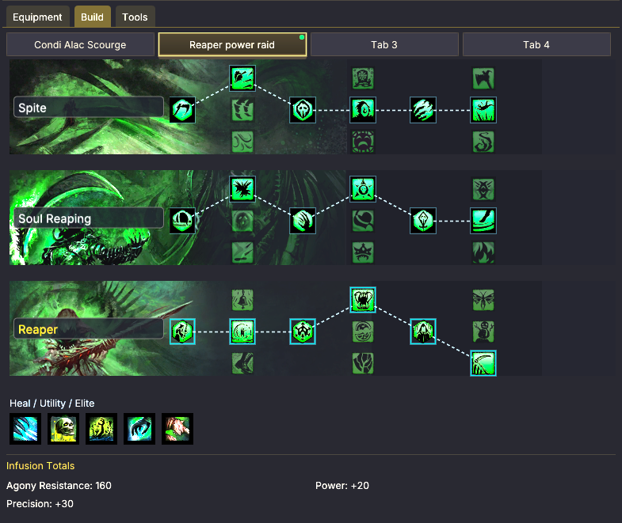
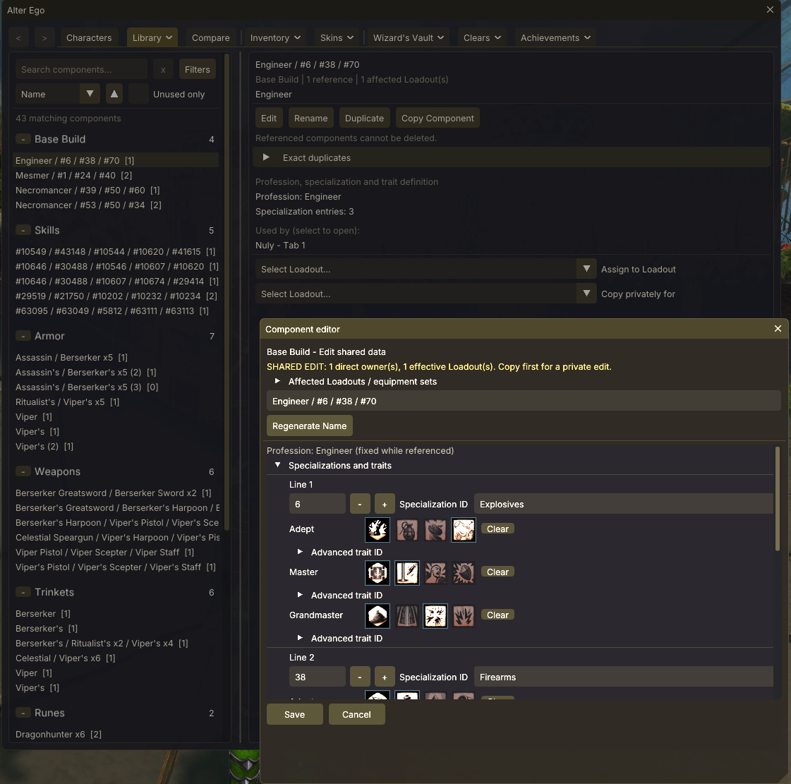
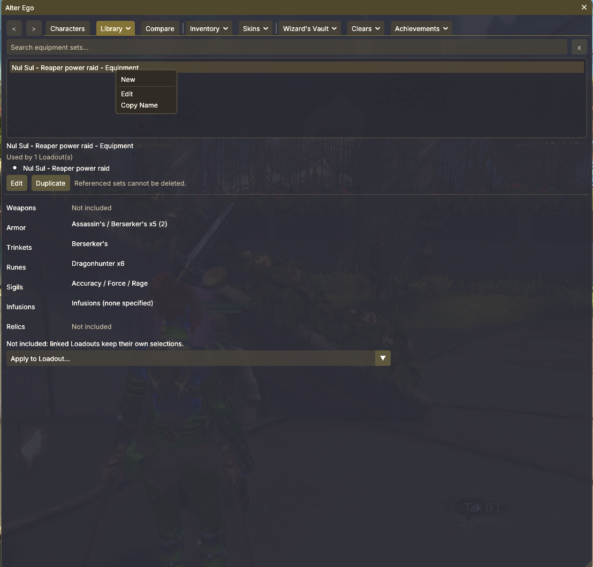
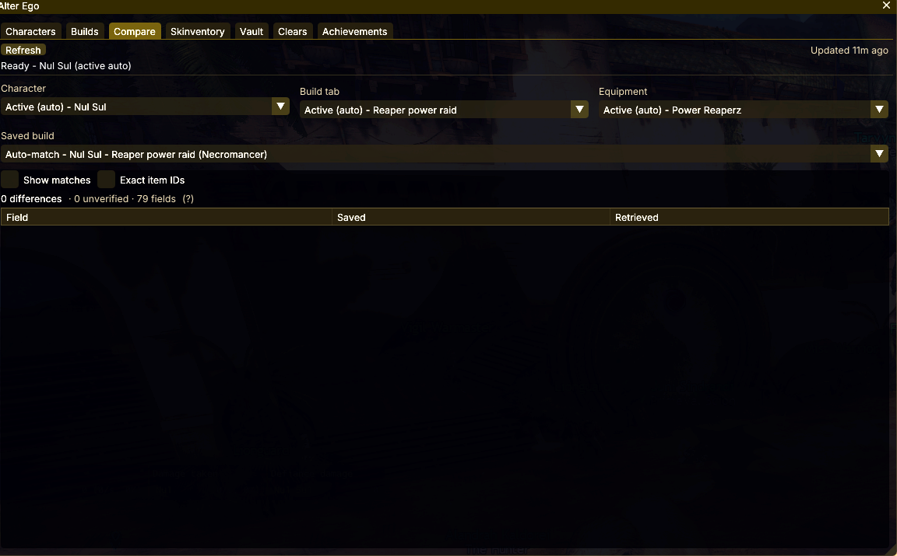
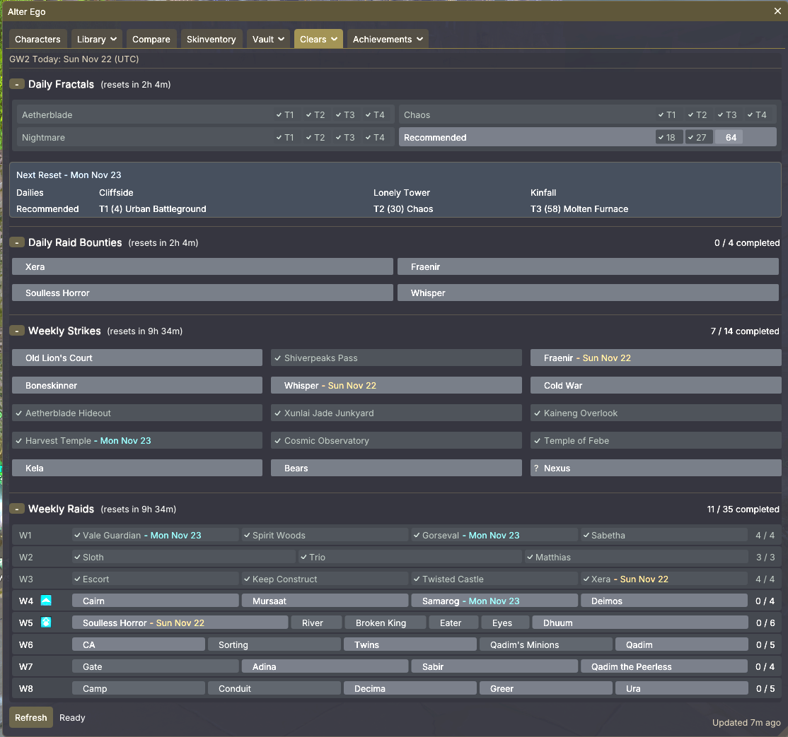

# Alter Ego

**Your Guild Wars 2 characters, loadouts, inventory, wardrobe and account progress — all in one place.**

Alter Ego is an addon for [Raidcore Nexus](https://raidcore.gg/Nexus) designed to make managing your Guild Wars 2 account easier without leaving the game.

Browse your characters without switching between them, organize reusable loadouts, compare equipment and builds, locate items across your accounts, and track your progress toward your next goal.

**Availability:** This is an experimental development version, not yet a Nexus catalog release. Screenshots may differ from the current interface.

## Getting started

**Requirements:** Guild Wars 2, [Raidcore Nexus](https://raidcore.gg/Nexus) (API v6), and a Guild Wars 2 API key for account features.

1. Install Nexus and obtain a trusted experimental build of Alter Ego from the maintainer.
2. Place `AlterEgo.dll` in your Guild Wars 2 `addons` directory and load it through Nexus. Do not load multiple copies simultaneously.
3. Create an API key at the [Guild Wars 2 account website](https://account.guildwars2.com/applications).
4. Open **Nexus → Alter Ego options**, enter your key and link your account.
5. Open Alter Ego from its quick-access icon. Browse Characters, select a character, and use Refresh to retrieve its details. Enable Automatic API Refresh in Nexus options if desired.

API key permissions

For full account functionality, enable:

| Permission | Purpose |
| --- | --- |
| `account` | Account identification |
| `characters` | Character information |
| `builds` | Build and equipment templates |
| `inventories` | Inventory and equipment |
| `wallet` | Currency balances |
| `unlocks` | Wardrobe and other unlocks |
| `progression` | Achievements and account progress |
| `guilds` | Guild information and accessible storage |
| `tradingpost` | Trading Post delivery items |

API keys are stored locally in Windows Credential Manager and are excluded from exports. Link additional accounts from the same options page.

Optional Nexus integrations: **Events: Chat** for chat link detection and **Events: Alerts** for skin unlock and achievement completion notifications.

## Features

### Characters

Browse your characters, equipment, build templates and gathering tools without switching characters. See recorded pets and legends, track your Ranger pet collection, and sort or personalize your character list. Fast Load lets you switch to eligible characters.

| Character Builds | Gathering Tools |
| --- | --- |
|  |  |

### Library

Save builds from your characters or create them independently. Import builds from Snow Crows, MetaBattle or supported build codes, and review updates before applying them.

A **Loadout** combines your build and equipment. Reusable **components** let multiple loadouts share individual parts, while **Equipment Sets** let them share groups of gear. Save **Fashion** separately from combat builds.

To import a guide or build code, open **Library → Import from Link / URL**.

| Loadouts | Components |
| --- | --- |
|  |  |
| **Equipment Sets** | **Equipment Customization** |
|  |  |

### Compare

Check a character against a saved loadout to see missing or mismatched traits, skills, gear and upgrades. Find relevant items you already own, or assign an expected loadout to track differences as you prepare your character.

### Inventory

Search your characters' bags and equipment, bank, shared inventory, material storage and Legendary Armory in one place. Filter or group results to locate items and quantities, browse wallet currencies and accessible guild storage, and view available Trading Post price estimates.

| Item Locations | Inventory Filters |
| --- | --- |
|  |  |

### Skins

Explore unlocked and missing wardrobe skins in list or grid view, track collection progress, and maintain a shopping list with Trading Post price estimates.

### Wizard's Vault, Clears and Achievements

Keep track of account objectives and recurring content without leaving the game.

- **Wizard's Vault:** Track daily, weekly and special objectives, with additional guidance for supported objectives.
- **Clears:** Track daily fractals, raid bounties, weekly strikes and raid encounters.
- **Achievements:** Search achievements, review completion progress and pin goals to a compact achievement tracker.

| Wizard's Vault | Clears |
| --- | --- |
|  |  |

### Multi-Account Support

Link multiple Guild Wars 2 accounts and browse their characters, inventory, currencies and progress from a single interface.

Your Loadout and Fashion libraries remain independent of your accounts, allowing saved builds and appearances to be reused across them.

## Using Alter Ego

- **Preparing a build:** Import or save a loadout in Library, then use Compare to see what your character is missing.
- **Finding an item:** Search Inventory and select a result to see its known locations.
- **Tracking goals:** Pin achievements to the compact tracker or check Wizard's Vault and Clears for recurring objectives.

Most game entities with supported chat links offer copy actions through their context menus.

## Settings

Open **Nexus → Alter Ego options** to manage linked accounts, enable automatic refresh (off by default), adjust window transparency and fonts, customize the character list, or configure Fast Load.

Manual Refresh remains available even when automatic refresh is disabled. Guild Wars 2 API data can lag behind in-game changes; cached information remains available while retrieval is underway.

### Custom character portraits

Place a PNG or JPEG named exactly after your character (for example, `My Ranger.png`) in `<GW2>/addons/AlterEgo/portraits/` and reselect the character. Rename the file yourself if your character is renamed. Characters with identical names share a portrait.

For custom fonts, place a `.ttf` file in `<GW2>/addons/AlterEgo/fonts/` and select it in Nexus options.

## Data and backups

Alter Ego stores data in an `AlterEgo/` folder beside the DLL, normally `<GW2>/addons/AlterEgo/`.

- Use **Library → Export** to back up selected library records, preferences and custom assets; use **Library → Import** to restore them or import supported original Alter Ego exports.
- Portable backups exclude credentials, linked account registry records and rebuildable caches. Relink accounts after moving to a new installation.
- Use **Storage & Cache** in Nexus options for cache maintenance. Rebuilding the cache preserves saved libraries and preferences.
- For a full local backup, unload the addon and copy the entire data folder. Credentials remain separate in Windows Credential Manager.

See [Privacy](PRIVACY.md) for data handling and [Architecture](docs/architecture.md#storage-ownership-and-recovery) for detailed storage information.

## Limitations

- Compare shows differences; it does not automatically equip gear or apply builds.
- Account details depend on API availability and may be delayed or incomplete. Unobserved Ranger pets are not necessarily locked, and owned items are not necessarily transferable.
- Fast Load depends on compatibility with the current game version and verified character ownership.
- This experimental version still requires in-game validation. See [development status](docs/development-status.md).

## Development

Alter Ego is written in C++ using the Nexus addon API, Dear ImGui and SQLite. Windows x64 builds and automated tests run through GitHub Actions.

Contributions and bug reports are welcome. See [Contributing](CONTRIBUTING.md), [Changelog](CHANGELOG.md), [Roadmap](docs/roadmap.md) and [Security](SECURITY.md).

Developer references: [Architecture](docs/architecture.md), [UI conventions](docs/ui-components.md), [Regression testing](docs/regression-testing.md), [Shared build format](docs/shared-build-spec.md), [Release checklist](docs/release-checklist.md) and [Agent instructions](AGENTS.md).

## Credits

Alter Ego is an independently maintained fork of [PieOrCake's original Alter Ego addon](https://github.com/PieOrCake/alter_ego).

Special thanks to:

- **PieOrCake** — Original creator of Alter Ego and its foundational character, build and sharing features.
- **Raidcore** — Nexus and its addon ecosystem.
- **ArenaNet** — Guild Wars 2 and the public API.
- **Guild Wars 2 Wiki contributors** — Public reference information and documentation.
- **Snow Crows and MetaBattle** — Community build resources.
- **Open-source contributors** — The libraries and tools that make this project possible.

Development is AI-assisted.

## License

Alter Ego's source code is licensed under the [MIT License](LICENSE).

See [Third-Party Notices](THIRD_PARTY_NOTICES.txt) for bundled dependencies, artwork and applicable third-party content licenses.

Alter Ego is an unofficial fan project and is not affiliated with or endorsed by ArenaNet, NCSOFT or Raidcore.
