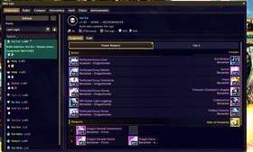
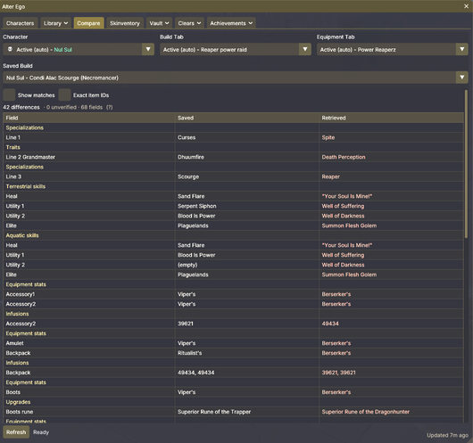
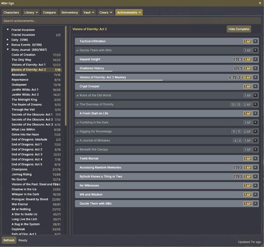

# Alter Ego

> [!IMPORTANT]
> **Unofficial Alter Ego feature fork — not an upstream release.** This repository is forked from [PieOrCake/alter_ego](https://github.com/PieOrCake/alter_ego). Credit for the original addon and its existing features belongs to the upstream project.
>
> **Enhanced version:** this fork's **`main`** branch contains the changes described below. This is a personal feature fork, separate from the original upstream release; these changes have not been submitted upstream.
>
> **Status:** actively used and tested in Guild Wars 2, but still undergoing further in-game evaluation. Development has been AI-assisted.

A Guild Wars 2 addon for [Raidcore Nexus](https://raidcore.gg/Nexus) that lets you view and manage all your characters, equipment, builds, and saved build templates — all without logging in to each character.

## What's different in this fork?

The following are **additions or changes relative to the original [PieOrCake Alter Ego](https://github.com/PieOrCake/alter_ego)**, not a list of features inherited unchanged from upstream.

| Area | Changes in this fork |
| --- | --- |
| **Saved builds and Compare** | Capture a retrieved character's build **and gear** into the library; dedicated saved-vs-retrieved comparison with build, skill, equipment, stat, infusion, relic, and utility checks; optional exact-item comparison; clearer difference and verification status. |
| **Character-first comparison** | Compare follows the logged-in character by default, auto-selects an appropriate saved build, keeps the **Character / Build Tab / Equipment Tab** selectors together, and shares the Characters tab's per-character refresh timestamp. Manual selection remains available. |
| **Character refresh and live signals** | Refresh the selected character directly, or use `...` to refresh multiple; optional auto-refresh on login or specialization change; warning when live specialization and cached build differ; locally tracked **Last Login** sorting. |
| **Vault and Clears** | Revised compact displays, clearer refresh feedback, better completion styling, daily fractal tier/scale information on hover, clearer weekly raid/strike layouts, and more consistent section headers and status presentation. |
| **Weekly Strikes** | Three-column responsive layout; encounters ordered like the in-game raid picker; shortened labels and full-name/expansion tooltips; `? Nexus` shown as **unknown**, not falsely completed or included in the existing 14-objective count. |
| **Weekly Raids** | Single-row **W1–W8** encounter grids at normal widths, with compact labels, per-wing completion totals, expansion/name tooltips, and Emboldened / Call of the Mists indicators. Often-skipped or secondary encounters are visually quieter. |
| **Shared completion styling** | Stronger distinction between available, secondary, and completed entries across Clears, Vault, and Achievements, without dimming entire groups more than necessary. |
| **Other UI refinements** | Cleaner refresh/status text, improved clipping and padding, Skinventory spacing improvements, and many smaller usability fixes across the addon. |

**What hasn't changed:** This is still Alter Ego, using [Raidcore Nexus](https://raidcore.gg/Nexus) and [Hoard & Seek](https://github.com/PieOrCake/hoard_and_seek). The fork does not introduce a separate GW2 API credential store or live memory-based gear reads. It keeps the original build-library data and upstream attribution.

**Code and build:** GitHub Actions builds and checks the Windows x64 **UCRT** DLL. CI success does not mean every game/UI interaction has been tested.

## AI Notice

This addon has been largely created using Claude. I understand that some folks have a moral, financial or political objection to creating software using an LLM. I just wanted to make a useful tool for the GW2 community, and this was the only way I could do it.

If an LLM creating software upsets you, then perhaps this repo isn't for you. Move on, and enjoy your day.

## Screenshots

<table>
  <tr>
    <td align="center"><a href="screenshots/characters.png"></a><br><sub>Characters &amp; Equipment</sub></td>
    <td align="center"><a href="screenshots/builds.png"></a><br><sub>Build Library</sub></td>
    <td align="center"><a href="screenshots/compare.png"></a><br><sub>Compare</sub></td>
  </tr>
  <tr>
    <td align="center"><a href="screenshots/skinventory.png"></a><br><sub>Skinventory</sub></td>
    <td align="center"><a href="screenshots/vault.png"></a><br><sub>Wizard's Vault</sub></td>
    <td align="center"><a href="screenshots/clears.png"></a><br><sub>Clears</sub></td>
  </tr>
  <tr>
    <td align="center"><a href="screenshots/achievements.png"></a><br><sub>Achievements</sub></td>
    <td></td>
    <td></td>
  </tr>
</table>

## Features

- **Multi-Account Support** — Switch between GW2 accounts from a single dropdown; all data is per-account
- **Characters** — Full character list with profession, level, birthday countdown, activity context, and sorting (including locally tracked **Last Login**)
- **Equipment** — Equipment tab viewer with tab selection, item details, infusions, sigils/runes, relics, and wardrobe template export for supported tabs
- **Builds** — Trait and skill viewer with library integration, chat-link support, and saved-build matching against the currently logged-in character
- **Build Library** — Save and manage builds with full trait/gear preview and game-mode filters. Builds are organized into collapsible profession groups with the same full-size +/- headers as Clears and Vault; drag the profession heading to move every build in the group, or drag individual builds to reorder inside their profession. Collapse state persists across sessions.
  - Save a retrieved build **plus selected equipment tab** directly into the library
  - Paste a **Snow Crows or MetaBattle build URL** into Import Build to save the full page name, game mode, profession, skills, traits, primary gear stats, runes/sigils, relic, and build-wide infusion quantities when present. MetaBattle's original GW2 template link is preserved. The original source URL remains attached; use **Open Source** or **Refresh Source** in the pinned build detail area. Refresh keeps your custom name and notes and leaves the saved build unchanged if the website cannot be downloaded or parsed.
  - Named ascended equipment prefixes (including **Zojja's = Berserker's** and **Yassith's = Viper's**) use one complete mapping shared by source imports and saved-vs-live comparisons. Fixed gear's itemstat IDs are verified against GW2 public item metadata; unknown names remain unverified rather than being guessed.
  - New Build and Import Build use the same action-button vocabulary and profession icon/color rendering as the character selectors. Import's help text is an in-field hint, and the game-mode combos use the shared themed selector.
  - Snow Crows infusion quantities use **total per active weapon set**, not arbitrary weapon-slot assignments. Captured local builds retain exact per-slot infusion requirements; Compare validates source-wide totals for weapon set A and B separately rather than double-counting both sets
  - Share full builds (including gear, runes, sigils) via `AE2:` compact codes ([spec →](docs/shared-build-spec.md)) or build-only using in-game chat links
  - Detect AE2 codes in GW2 chat and offer one-click import
- **Compare** — Dedicated saved-vs-retrieved comparison with automatic character/build selection, shared profession-colored names/icons, equipment tab selection even when no saved build matches, equipment status, optional exact-item matching, and refresh controls
- **Skinventory** — Browse all skins, track ownership per account, filter owned/unowned, maintain a shopping list, and open wiki pages
- **Vault** — Wizard's Vault daily, weekly, and special objectives with progress, claimed state, and compact completion styling. When reopening after 15 minutes of stale data, automatically refresh only unclaimed sections; manual Refresh always fetches all three sections.
- **Clears** — Daily fractals, daily raid bounties, weekly strikes, and weekly raids with compact layouts, improved completion visualization, and contextual hover detail. Stale completion data is refreshed on tab entry (15-minute threshold), skipping fully completed sections; manual Refresh still fetches all categories.
- **Achievements** — Searchable achievement browser with pinning and a popout tracker
- **Hoard & Seek Integration** — All API data is sourced through [Hoard & Seek](https://github.com/PieOrCake/hoard_and_seek)

## Character Portraits

You can replace the default character avatar used by Alter Ego with your own character screenshots.

1. Navigate to your GW2 addons directory: `<GW2>/addons/AlterEgo/portraits/`
   - This folder is created automatically when the addon first runs
2. Save a screenshot with the **exact character name** as the filename:
   - `Woofy Mcdogface.png`
   - `My Cool Character.jpg`
3. Supported formats: `.png`, `.jpg`, `.jpeg`
4. Re-select the character (or switch away and back) to refresh the portrait if it was already loaded

Custom portraits are currently shown through Alter Ego's shared character-avatar renderer, most visibly in the **Characters** view header/avatar. Replacing a portrait file on disk is detected automatically after the portrait cache for that character is refreshed.

## Requirements

- [Raidcore Nexus](https://raidcore.gg/Nexus) (API v6)
- [Hoard & Seek](https://github.com/PieOrCake/hoard_and_seek) addon (provides character data via GW2 API)
- [Events: Chat](https://raidcore.gg/Nexus) addon (optional — enables chat build detection)
- [Events: Alerts](https://raidcore.gg/Nexus) addon (optional — enables real-time skin unlock and achievement completion detection)

## Installation

Copy `AlterEgo.dll` to your GW2 Nexus addons directory:

```text
<GW2>/addons/AlterEgo.dll
```

The addon stores its data (settings, build library, portraits, caches) in:

```text
<GW2>/addons/AlterEgo/
```

## Building

Cross-compiled for Windows on Linux using the **UCRT** MinGW-w64 toolchain (rather than the legacy MSVCRT target). On Debian 13:

```bash
sudo apt-get install cmake make g++-mingw-w64-ucrt64 gcc-mingw-w64-ucrt64 binutils-mingw-w64-ucrt64
cmake -S . -B build -DCMAKE_BUILD_TYPE=Release -DCMAKE_CXX_FLAGS=-mcrtdll=ucrtbase -DCMAKE_C_FLAGS=-mcrtdll=ucrtbase
cmake --build build --parallel 2
```

Output: `build/AlterEgo.dll`. Use `objdump -p build/AlterEgo.dll` to verify a UCRT import and no import from `msvcrt.dll`.

## Dependencies

- **ImGui 1.80** — Immediate mode GUI (bundled in `lib/imgui/`)
- **nlohmann/json** — JSON parsing (bundled in `lib/nlohmann/`)
- **Nexus API v6** — Raidcore Nexus addon API (header in `include/nexus/`)

## License

MIT

## Save a retrieved build and compare it to a saved build (local extension)

In **Characters**, select a character and open either **Equipment** or **Build**. The **Save** and **Share** buttons appear together at the top of both views, above their respective equipment/build tab selectors. **Save** opens the *Save Current Build + Gear to Library* dialog; the full description is available on hover. **Share** exports the selected character's retrieved build and equipment directly, without using or changing a saved library entry. It captures the selected build tab (or the active build if none was selected). From **Equipment**, the currently viewed equipment set is preselected; from **Build**, the active equipment set is preselected. You can also right-click a build tab and select **Save to Library...**. Give the snapshot a name, choose a game mode, and confirm which retrieved equipment tab to capture. **Include equipment set** defaults to on. The capture copies the retrieved trait and skill IDs directly, so it works even when the build-link palette is still loading. Your previously saved sets are not changed.

Open the dedicated **Compare** top-level tab. By default, **Character** follows the currently logged-in hero (**Active (auto)**) and the **Saved build** selection auto-matches that character. The three-column **Character / Build Tab / Equipment Tab** selector row uses bright, aligned labels, with **Saved Build** underneath. Character dropdown names and icons reuse the Characters roster's profession styling and ordering; Equipment Tab always shows the retrieved character's tabs whether or not a saved build or equipment snapshot exists. You can manually select another character or saved build. You can also click **Compare** in **Build Library** to preselect that saved build. The default view shows only differences; check **Show matches** for all compared fields. **Compare exact item IDs** is optional because identical functional gear may use different item IDs. You can refresh the chosen character through Hoard & Seek from the comparison tab. Comparisons do not apply equipment, skills, or changes to saved builds.

Newly captured library builds store an optional source-character name. This helps identify their origin but does **not** override the active character when Compare is in automatic mode. Only same-profession library builds are offered for manual comparison; if no suitable saved build is found, Compare shows that explicitly rather than silently comparing the wrong character. The build and equipment selectors default to **Active (auto)**, which follows the latest Hoard & Seek active-tab data after refreshing; manually selecting a tab overrides that behavior.

The Characters list shows a matching saved build for the **logged-in character only**, caching comparisons until the active character, its retrieved data, or the saved library changes. When several saved builds share the same build template, it displays the **closest equipment match** (preferring a verified full gear match, then fewer known differences) and shows how many saved variants share the template. Equipment receives its own explicit status: **MATCHES**, **DOES NOT MATCH**, **MISSING ITEM**, **DATA MISSING**, or **NOT SAVED**. Different itemstat IDs are compared by public stat name and attribute definitions when possible. If metadata is incomplete, the field is marked **not verified** rather than reported as a mismatch or match; these fields do not count toward a confirmed full gear match. These labels reflect the latest retrieved H&S character snapshot, not a live memory read.

**Data limitations:** The comparison uses the most recently retrieved Hoard & Seek data, not an instantaneous memory read from the game. Older library entries only contain the gear values they previously recorded: missing fields are not assumed to be absent from the original build. Newly captured library entries also record the original item IDs and infusion lists for optional comparison. Shared relics from the supplemental equipment endpoint (equipment tab 0) are captured into the selected numbered equipment set and compared correctly; unrelated shared tool slots are excluded.

## Character sorting: Last Login

The Characters sort dropdown includes **Last Login** (newest first). It uses locally recorded MumbleLink character-login timestamps already shown in the character header and saved to `login_times.json`; it does not request the GW2 API's `last_modified` field. Switching characters automatically updates the order without changing the currently selected roster entry. The direction arrow reverses oldest/newest among known logins; unobserved characters remain at the bottom in either direction. Existing Custom sorting and saved sort IDs are preserved. Logins before Alter Ego began recording are not recoverable.

## Optional live specialization warning and automatic refresh

Nexus options > **Data Source: Hoard & Seek** now has an **Automatic Character Refresh** subsection. Automatic refresh is **off by default** (explicit opt-in). When enabled, the independent **When a character logs in** and **When specialization changes** options schedule a refresh for the currently played character only. Both use Nexus's existing MumbleLink identity event; **RTAPI is not required**. Rapid events are coalesced with an 8-second debounce, and only one automatic request per character is dispatched within a 90-second cooldown. Requests wait for Hoard & Seek to be ready and an in-flight fetch to finish; selected-character refreshes also refuse to overwrite an active fetch.

The separately configurable **Warn when live specialization differs from retrieved build** option is on by default and compares MumbleLink's third specialization ID against the cached active build's third specialization. When both values are known but differ, a warning appears for the logged-in character in the roster and on Compare. Unknown/zero values do not trigger a warning. The warning does **not** imply that full gear details are available from live memory: both equipment and build templates still come from the GW2 API through Hoard & Seek, and the API may return stale cached data. Automatic refresh does not detect two builds that share the same third specialization or equipment-only switches.
