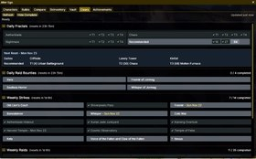

# Alter Ego

A Guild Wars 2 addon for [Raidcore Nexus](https://raidcore.gg/Nexus) that lets you view and manage all your characters, equipment, builds, and saved build templates — all without logging in to each character.

## AI Notice

This addon has been largely created using Claude. I understand that some folks have a moral, financial or political objection to creating software using an LLM. I just wanted to make a useful tool for the GW2 community, and this was the only way I could do it.

If an LLM creating software upsets you, then perhaps this repo isn't for you. Move on, and enjoy your day.

## Screenshots

<table>
  <tr>
    <td align="center"><a href="screenshots/equipment.png"></a><br><sub>Equipment</sub></td>
    <td align="center"><a href="screenshots/build.png"></a><br><sub>Build</sub></td>
    <td align="center"><a href="screenshots/library.png"></a><br><sub>Build Library</sub></td>
  </tr>
  <tr>
    <td align="center"><a href="screenshots/clears.png"></a><br><sub>Vault &amp; Clears</sub></td>
    <td align="center"><a href="screenshots/vault.png"></a><br><sub>Wizard's Vault</sub></td>
    <td align="center"><a href="screenshots/cheevs.png"></a><br><sub>Achievements</sub></td>
  </tr>
  <tr>
    <td align="center"><a href="screenshots/tracker.png"></a><br><sub>Tracker popout</sub></td>
    <td align="center"><a href="screenshots/skinventory.png"></a><br><sub>Skinventory</sub></td>
    <td></td>
  </tr>
</table>

## Features

- **Multi-Account Support** — Switch between GW2 accounts from a single dropdown; all data is per-account
- **Characters** — Full character list with profession, level, and birthday countdown; sortable and drag-to-reorder
- **Equipment** — Paper-doll layout with rarity borders, sigil/rune/infusion tooltips, dye swatches, and custom portraits
- **Builds** — Trait grid and skill bar viewer; copy build chat link to clipboard
- **Build Library** — Save and manage builds with full trait/gear preview; filter by profession and game mode
  - Share full builds (including gear, runes, sigils) via `AE2:` compact codes ([spec →](docs/shared-build-spec.md)) or build-only using in-game chat links
  - Online relay to share builds with the (upcoming) Alter Ego mobile app via short codes
  - Detects AE2 codes in GW2 chat and offers one-click import
- **Skinventory** — Browse all skins, track ownership per account, shopping list, wiki images and prices
- **Vault & Clears** — Wizard's Vault objectives (daily/weekly/special) and raid/fractal completion tracking
  - Vault: meta progress, per-objective acclaim, track, progress, and claimed state
  - Clears: Daily Fractals by tier, Daily Bounties, Weekly Strikes, Weekly Raids per-encounter
- **Achievements** — Full achievement tree with search, pin up to 20 for tracking, floating tracker window, waypoint copy, real-time completion alerts
- **Hoard & Seek Integration** — All API data sourced via [Hoard & Seek](https://github.com/PieOrCake/hoard_and_seek)

## Character Portraits

You can replace the default race concept art in the equipment panel with your own character screenshots.

1. Navigate to your GW2 addons directory: `<GW2>/addons/AlterEgo/portraits/`
   - This folder is created automatically when the addon first runs
2. Save a screenshot with the **exact character name** as the filename:
   - `Woofy Mcdogface.png`
   - `My Cool Character.jpg`
3. Supported formats: `.png`, `.jpg`, `.jpeg`
4. Click the character in the list to refresh the portrait

Portraits are displayed as a semi-transparent overlay with a vignette edge fade. The aspect ratio is preserved automatically. Replacing a portrait file on disk is detected automatically — just click the character again to refresh.

## Requirements

- [Raidcore Nexus](https://raidcore.gg/Nexus) (API v6)
- [Hoard & Seek](https://github.com/PieOrCake/hoard_and_seek) addon (provides character data via GW2 API)
- [Events: Chat](https://raidcore.gg/Nexus) addon (optional — enables chat build detection)
- [Events: Alerts](https://raidcore.gg/Nexus) addon (optional — enables real-time skin unlock and achievement completion detection)

## Installation

Copy `AlterEgo.dll` to your GW2 Nexus addons directory:
```
<GW2>/addons/AlterEgo.dll
```

The addon stores its data (settings, build library, portraits, caches) in:
```
<GW2>/addons/AlterEgo/
```

## Building

Cross-compiled for Windows on Linux using the **UCRT** MinGW-w64 toolchain
(rather than the legacy MSVCRT target). On Debian 13:

```bash
sudo apt-get install cmake make g++-mingw-w64-ucrt64 gcc-mingw-w64-ucrt64 binutils-mingw-w64-ucrt64
cmake -S . -B build -DCMAKE_BUILD_TYPE=Release -DCMAKE_CXX_FLAGS=-mcrtdll=ucrtbase -DCMAKE_C_FLAGS=-mcrtdll=ucrtbase
cmake --build build --parallel 2
```

Output: `build/AlterEgo.dll`. Use `objdump -p build/AlterEgo.dll` to verify
a UCRT import and no import from `msvcrt.dll`.

## Dependencies

- **ImGui 1.80** — Immediate mode GUI (bundled in `lib/imgui/`)
- **nlohmann/json** — JSON parsing (bundled in `lib/nlohmann/`)
- **Nexus API v6** — Raidcore Nexus addon API (header in `include/nexus/`)

## License

MIT

## Save a retrieved build and compare it to a saved build (local extension)

In **Characters → Builds**, select a character and build tab. Click **Save Current
Build + Gear to Library...** (or right-click the build tab and select **Save to
Library...**). Give the snapshot a name, choose a game mode, and select which
retrieved equipment tab to capture. **Include equipment set** defaults to on.
The capture copies the retrieved trait and skill IDs directly, so it works even
when the build-link palette is still loading. Your previously saved sets are
not changed.

Open the dedicated **Compare** top-level tab, select a **Saved build**, then
choose a character of the same profession, a retrieved build tab, and (if gear
was saved) an equipment tab. You can also click **Compare to Retrieved
Character...** from the selected build in **Build Library** to open the Compare
tab with that build preselected. The default view shows only differences;
check **Show matches** for all compared fields. **Compare exact item IDs** is
optional because identical functional gear may use different item IDs. You can
refresh the chosen character through Hoard & Seek from the comparison tab.
Comparisons do not apply equipment, skills, or changes to saved builds.

Newly captured library builds store an optional source-character name. Compare
prefers that exact character on first opening; older snapshots with an
unambiguous "<character name> - Tab N" title can infer it without migrating
existing data. The build and equipment selectors default to **Active (auto)**,
which follows the latest Hoard & Seek active-tab data after refreshing;
manually selecting a tab overrides that behavior. The Compare refresh button
shows progress and success/error feedback, but a completed fetch does not
guarantee that the GW2 API has already published the most recent in-game change.

The Characters list shows a matching saved build for the **logged-in character
only**, caching comparisons until the active character, its retrieved data, or
the saved library changes. When several saved builds share the same build
template, it displays the **closest equipment match** (preferring a verified
full gear match, then fewer known differences) and shows how many saved
variants share the template. Equipment receives its own explicit status:
**MATCHES**, **DOES NOT MATCH**, **MISSING ITEM**, **DATA MISSING**, or
**NOT SAVED**. Different itemstat IDs are compared by public
stat name and attribute definitions when possible. If the metadata is
incomplete, the field is marked **not verified** rather than reported
as a mismatch or match; these fields do not count toward a confirmed full
gear match. These labels reflect the latest retrieved H&S character snapshot,
not a live memory read.

**Data limitations:** The comparison uses the most recently retrieved Hoard & Seek
data, not an instantaneous memory read from the game. Older library entries
only contain the gear values they previously recorded: missing fields are not
assumed to be absent from the original build. Newly captured library entries
also record the original item IDs and infusion lists for optional comparison.
Shared relics from the supplemental equipment endpoint (equipment tab 0)
are captured into the selected numbered equipment set and compared correctly;
unrelated shared tool slots are excluded.
The existing AE2 chat/relay sharing formats do not include those extra fields,
so an AE2-imported build may support fewer equipment comparisons. GW2 may not
expose a selected legendary relic effect as a conventional item ID; verify
those cases in-game.

To produce a Windows DLL on GitHub without maintaining a build server, fork
this repository and use **Actions → Build Alter Ego Windows DLL → Run workflow**.
Download the `AlterEgo-UCRT-Windows-x64` artifact from the successful
run. You can also cross-compile on Debian with MinGW by following **Building**.
