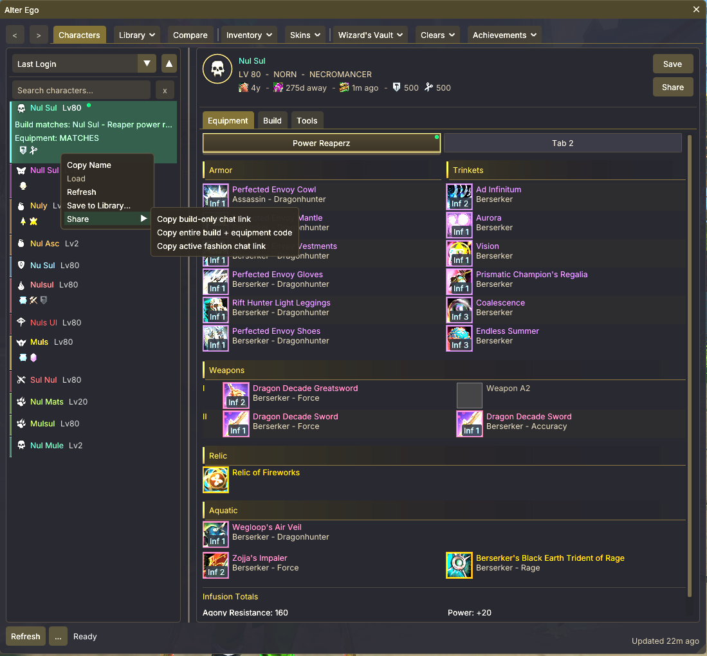
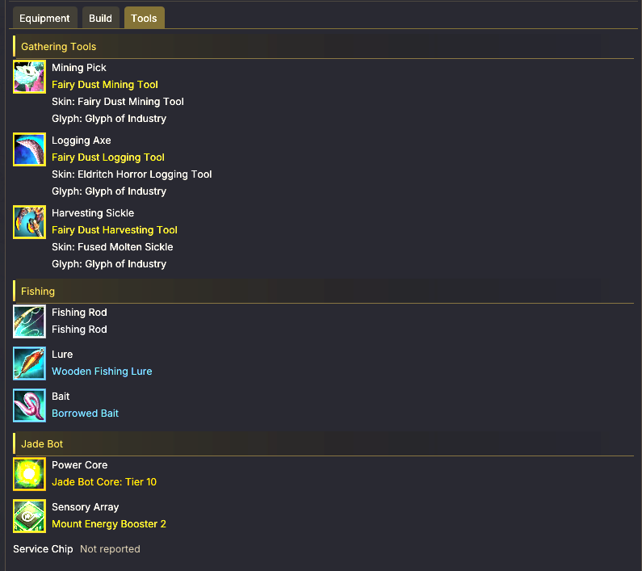
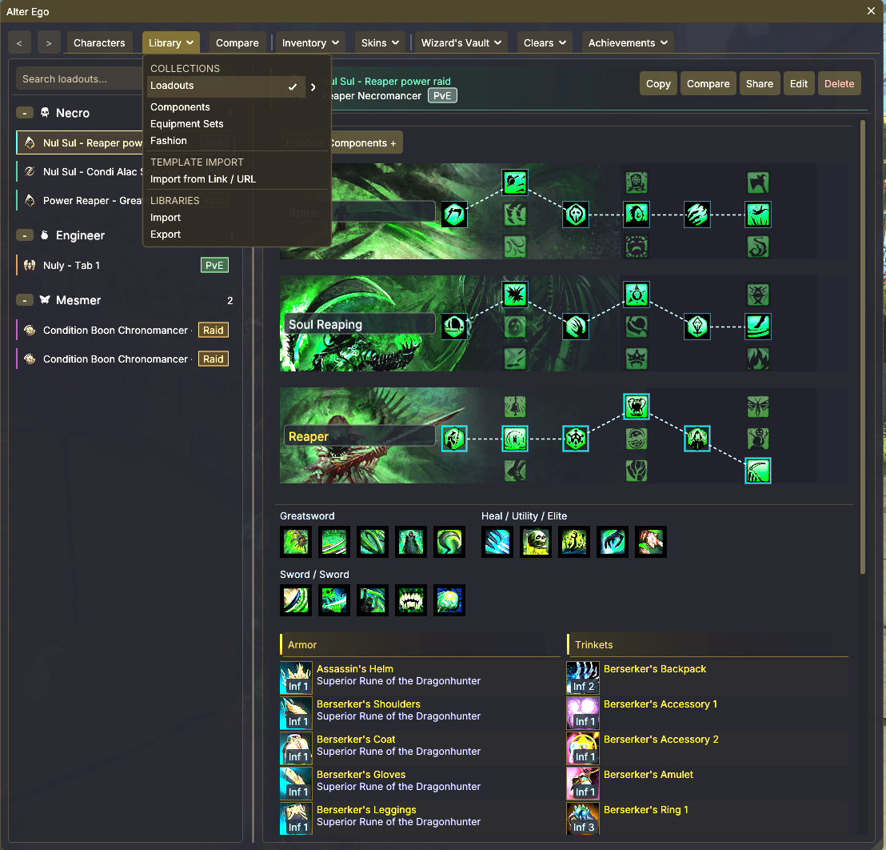
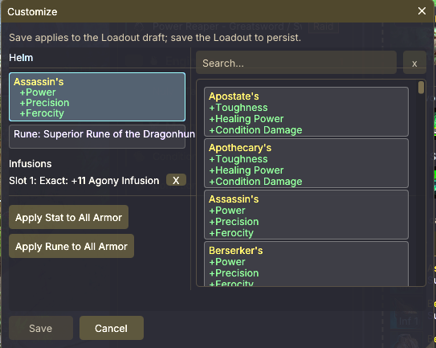
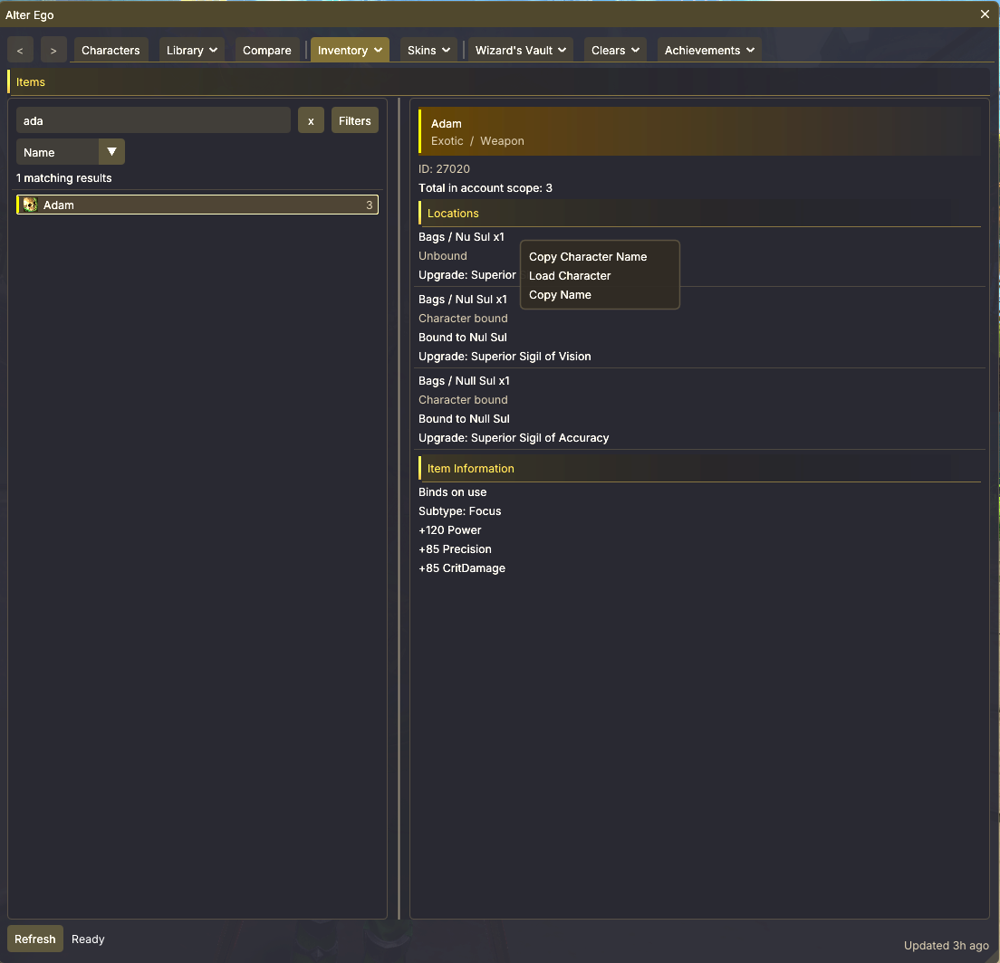
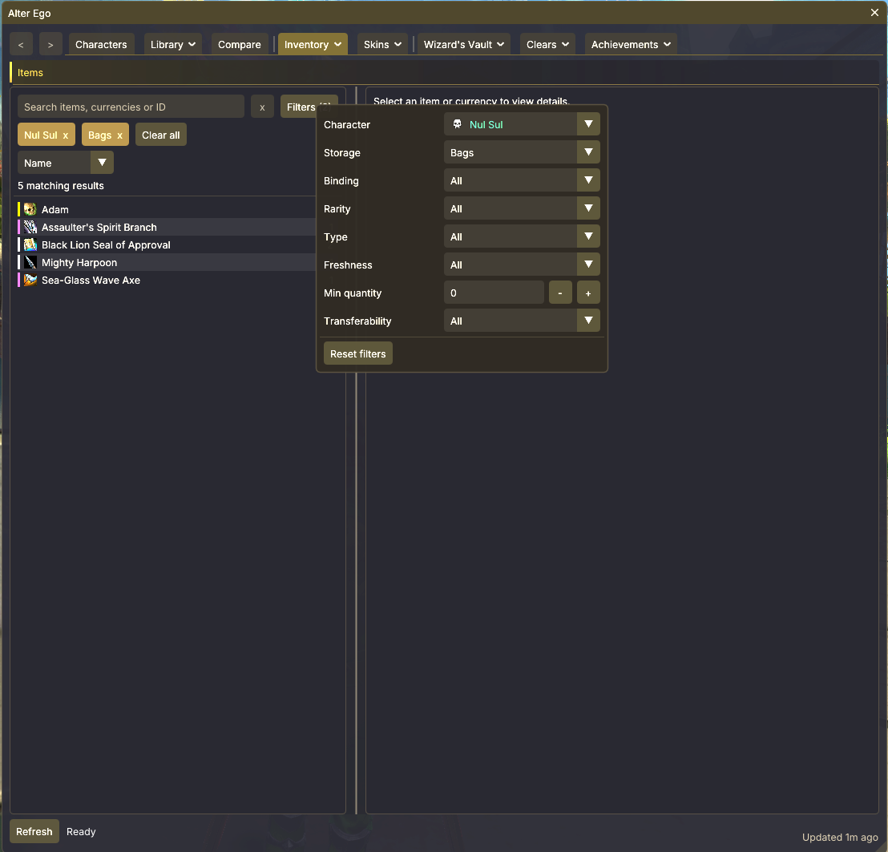
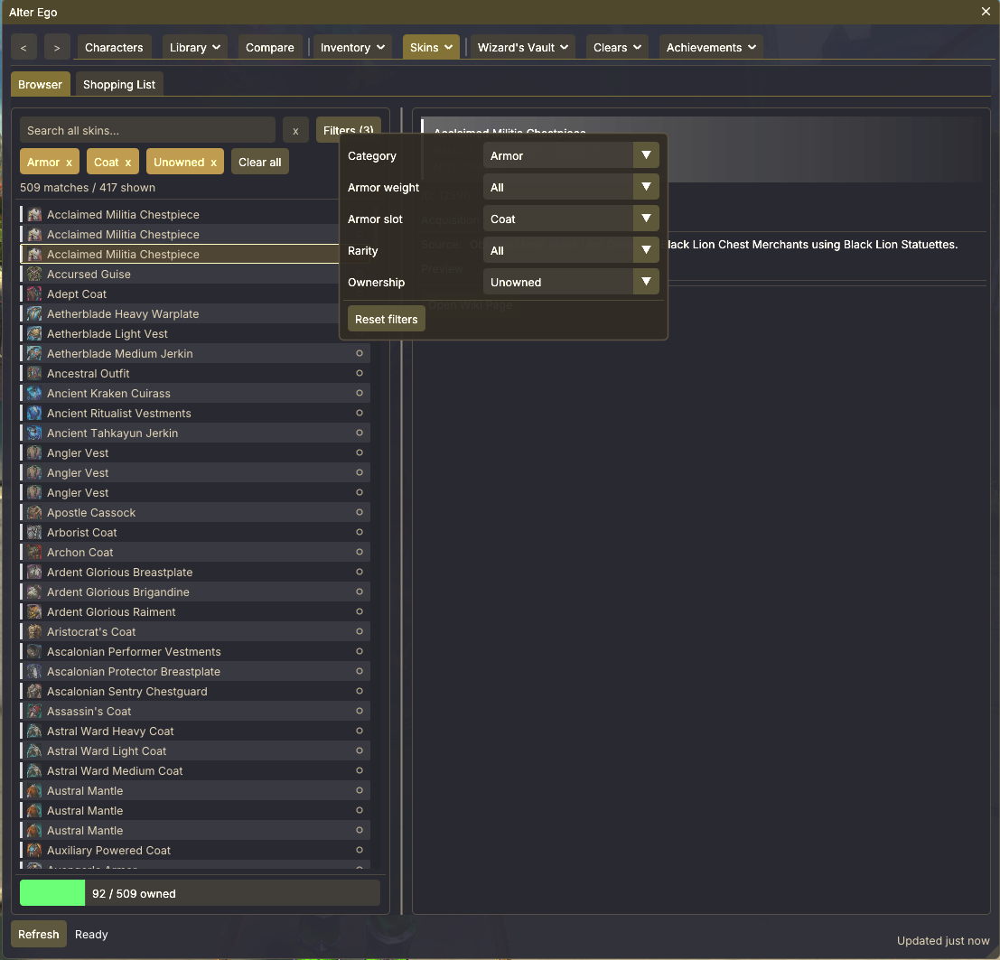
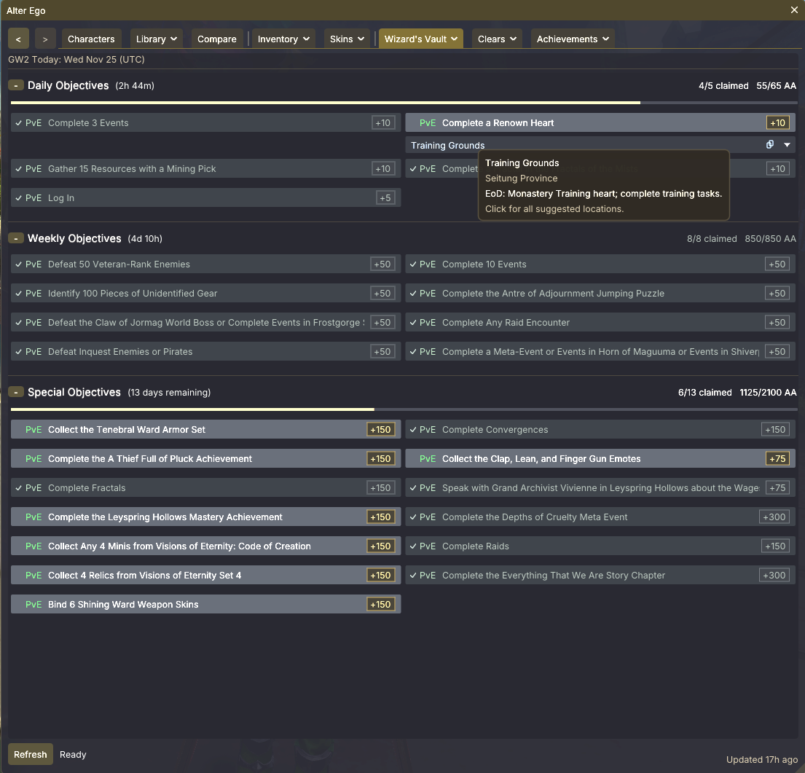
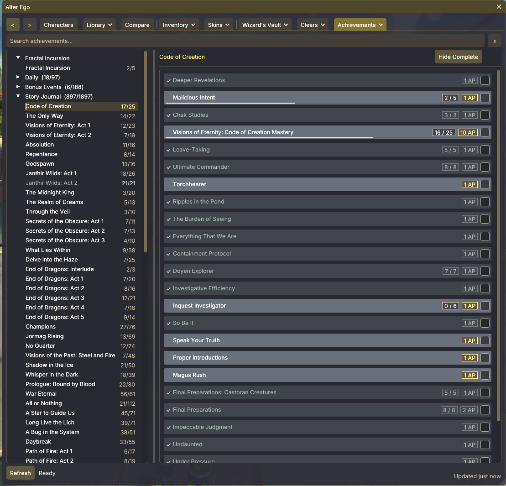

# Alter Ego

**Your Guild Wars 2 characters, loadouts, inventory, wardrobe and account progress — all in one place.**

Alter Ego is an addon for [Raidcore Nexus](https://raidcore.gg/Nexus) designed to make managing your Guild Wars 2 account easier without leaving the game.

Browse your characters without switching between them, organize reusable loadouts, compare equipment and builds, locate items across your accounts, and track your progress toward your next goal.



## Features

### Characters

- Browse characters, builds, equipment, crafting disciplines and gathering tools.
- View equipment templates, upgrades, infusions and glyphs.
- Identify which saved loadout matches your active character.
- Sort characters by name, profession, level, age, birthday, last login or custom order.
- Quickly switch between eligible characters using Fast Load.
- Personalize your character list with custom portraits.

| Character Builds | Gathering Tools |
| --- | --- |
| [](screenshots/characters-build.png) | [](screenshots/characters-tools.png) |

### Library

Build and maintain a personal collection of loadouts, reusable components, equipment sets and appearances.

- Save complete loadouts directly from your characters.
- Create and customize loadouts independently of your characters.
- Reuse build, skill and equipment components across multiple loadouts.
- Share Equipment Sets between loadouts, so changes can be managed in one place.
- Organize loadouts by profession and game mode.
- Save Fashion independently of combat builds.
- Import builds from Snow Crows, MetaBattle and supported chat links.
- Share and transfer library data using portable exports.

Equipment Sets can contain only the equipment categories you want to share, allowing individual loadouts to retain their own equipment choices.

| Loadouts | Components |
| --- | --- |
| [](screenshots/library-loadouts.png) | [](screenshots/library-components.png) |
| **Equipment Sets** | **Equipment Customization** |
| [](screenshots/library-equipment-sets.png) | [](screenshots/equipment-customization.png) |

### Compare

Compare your characters against saved loadouts to identify what needs to change.

- Compare traits, skills, equipment, stats and upgrades.
- Identify missing or mismatched equipment.
- Find relevant items already owned by your account.
- Compare individual equipment and build templates.
- Recognize functional matches without requiring identical utility skill ordering.


### Inventory

Find what you own without manually searching through characters and storage.

- Search across character inventories, equipped items, bank, shared inventory, material storage and Legendary Armory.
- Locate individual items and their quantities.
- Filter by character, storage location, rarity, item type and other attributes.
- Browse wallet currencies and pin frequently used currencies.
- Browse accessible guild bank storage.
- Navigate directly to relevant inventory results from other areas of Alter Ego.

| Item Locations | Inventory Filters |
| --- | --- |
| [](screenshots/inventory-item-locations.png) | [](screenshots/inventory-filters.png) |

### Skins

Explore your wardrobe and work toward completing your collection.

- Browse unlocked and missing skins.
- Filter by category, rarity, weapon type, armor weight and ownership.
- View collection progress.
- Browse using list or grid layouts.
- Maintain a shopping list with Trading Post price estimates and eligible owned-stock information.



### Wizard's Vault, Clears and Achievements

Keep track of account objectives and recurring content without leaving the game.

- **Wizard's Vault:** Track daily, weekly and special objectives, with additional guidance for supported objectives.
- **Clears:** Track daily fractals, raid bounties, weekly strikes and raid encounters.
- **Achievements:** Search achievements, review completion progress and pin goals to a compact achievement tracker.

| Wizard's Vault | Clears |
| --- | --- |
| [](screenshots/wizards-vault.png) | [](screenshots/clears.png) |



### Multi-Account Support

Link multiple Guild Wars 2 accounts and browse their characters, inventory, currencies and progress from a single interface.

Your Loadout and Fashion libraries remain independent of your accounts, allowing saved builds and appearances to be reused across them.

## Getting Started

### Requirements

- Guild Wars 2
- [Raidcore Nexus](https://raidcore.gg/Nexus) (API v6)
- A Guild Wars 2 API key for account-related features

Optional Nexus integrations:

- **Events: Chat** — Chat link detection.
- **Events: Alerts** — Skin unlock and achievement completion notifications.

### Installation

1. Install Raidcore Nexus.
2. Place `AlterEgo.dll` in your Guild Wars 2 `addons` directory.
3. Load Alter Ego through Nexus.
4. Open Alter Ego using its quick-access icon.

> [!NOTE]
> This version of Alter Ego is under active development and is not currently a published Nexus catalog release. Do not load multiple copies of Alter Ego simultaneously.

### API Key Setup

Create an API key at the [Guild Wars 2 account management website](https://account.guildwars2.com/applications).

For full functionality, enable the following permissions:

| Permission | Purpose |
| --- | --- |
| `account` | Account identification |
| `characters` | Character information |
| `builds` | Build and equipment templates |
| `inventories` | Inventory and equipment |
| `wallet` | Currency balances |
| `unlocks` | Wardrobe and other unlocks |
| `progression` | Achievements and account progress |
| `guilds` | Guild information and accessible storage |
| `tradingpost` | Delivery box / Trading Post account information |

Open **Nexus → Alter Ego options** to enter your API key and link your account.

Additional accounts can be linked from the same settings page.

API keys are stored locally in Windows Credential Manager and are excluded from library exports.

## Automatic Refresh

Alter Ego maintains a local cache of retrieved account information.

Automatic refresh is optional and can be configured individually for different types of account data. Refreshes are designed around actual usage, data freshness and API propagation delays rather than continuously retrieving everything.

Manual refresh remains available when needed.

Guild Wars 2 API data may lag behind changes made in-game. Recently changed equipment, builds and inventory may not appear immediately.

## Custom Character Portraits

You can personalize your character profiles by adding custom portraits to:

```text
<GW2>/addons/AlterEgo/portraits/
```

Name the image exactly as your character appears in-game.

Supported formats:

- PNG
- JPG
- JPEG

Re-select your character to display the updated portrait.

## Data and Backups

Alter Ego stores its local data under:

```text
<GW2>/addons/AlterEgo/
```

| Location | Contents |
| --- | --- |
| `library/` | Saved loadouts, components, equipment sets and Fashion |
| `config/` | Settings, preferences and activity history |
| `cache/` | Rebuildable account data and reference information |
| `portraits/` | Custom character portraits |
| `fonts/` | Custom fonts |
| `backups/` | Recovery snapshots and migration backups |

Saved Loadout and Fashion libraries use SQLite and are stored separately from rebuildable cached data.

Use **Library → Import / Export** to back up or transfer your library, preferences and custom assets.

Recognized original Alter Ego build-library exports can also be imported.

Cache inspection and maintenance are available under **Storage & Cache** in Nexus options. Rebuilding the cache does not remove your saved library.

Regular backups are recommended, particularly before upgrading experimental builds.

For more information about local storage, credentials and external services, see the [Privacy Policy](PRIVACY.md).

## Limitations

- Compare identifies differences but does not automatically equip items or apply builds.
- Character and account information is subject to Guild Wars 2 API availability and update delays.
- Some equipment, fashion and gathering tool details may be incomplete when they are not reported by the API.
- Fast Load depends on compatibility with the current game version and verified character ownership.
- Inventory ownership does not necessarily mean an item can be transferred or used by another character.

## Development

Alter Ego is written in C++ using the Nexus addon API, Dear ImGui and SQLite.

Windows x64 UCRT builds and automated regression testing are performed through GitHub Actions.

Contributions, bug reports and feature suggestions are welcome.

### Project Documentation

- [Contributing](CONTRIBUTING.md)
- [Changelog](CHANGELOG.md)
- [Roadmap](docs/roadmap.md)
- [Current development and validation status](docs/development-status.md)
- [Release checklist](docs/release-checklist.md)
- [Architecture](docs/architecture.md)
- [UI Conventions](docs/ui-components.md)
- [Regression Testing](docs/regression-testing.md)
- [Shared Build Format](docs/shared-build-spec.md)
- [Agent Instructions](AGENTS.md)
- [Security](SECURITY.md)

## Credits

Alter Ego is an independently maintained fork of [PieOrCake's original Alter Ego addon](https://github.com/PieOrCake/alter_ego).

Special thanks to:

- **PieOrCake** — Original creator of Alter Ego and its foundational character, build and sharing features.
- **Raidcore** — Nexus and its addon ecosystem.
- **ArenaNet** — Guild Wars 2 and the public API.
- **Guild Wars 2 Wiki contributors** — Public reference information and documentation.
- **Snow Crows and MetaBattle** — Community build resources.
- **Open-source contributors** — The libraries and tools that make this project possible.

Development is AI-assisted.

## License

Alter Ego's source code is licensed under the [MIT License](LICENSE).

See [Third-Party Notices](THIRD_PARTY_NOTICES.txt) for bundled dependencies, artwork and applicable third-party content licenses.

Alter Ego is an unofficial fan project and is not affiliated with or endorsed by ArenaNet, NCSOFT or Raidcore.
